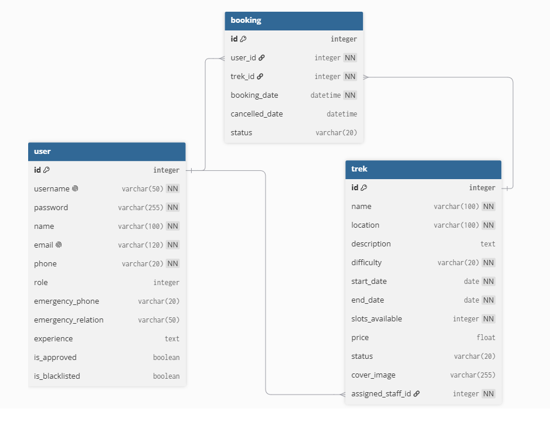

# TrekAarohan-Classic

A Trekking Management Application handling trek approvals, staff assignments, and participant bookings. Built on a traditional MVC stack using HTML/CSS, SQLite, Flask, and Jinja2.

## Features
- **Admin Dashboard**: Manage all treks, assign staff, and oversee all system users and bookings.
- **Staff Dashboard**: Manage assigned treks, update trek status, and manage participants.
- **Trekker Dashboard**: Browse available treks, book slots, and track past and upcoming adventures.
- **Role-Based Access Control**: Secure logins using Flask-Login to route users to their dedicated views.
- **Robust Validation**: Backend constraints to prevent overbooking and invalid data entry.

## Setup Instructions

### 1. Install Dependencies
Ensure that Python is installed. Then, install the required packages (Flask, SQLAlchemy, etc.):
```bash
pip install -r requirements.txt
```

### 2. Initialize the Database
Before running the application for the first time, initialize the SQLite database and create the default Admin account:
```bash
python init_db.py
```
*Note: This will generate a `tac.db` file inside the `instance/` folder.*

### 3. Start the Server
Run the Flask application:
```bash
python app.py
```
The server will start locally. Open your web browser and navigate to:
**http://127.0.0.1:5000**

## Default Admin Account

Once the database is initialized, one can log in using the pre-created Admin account:
- **Username:** admin
- **Password:** admin123

From the Admin Dashboard, start creating Treks and approving newly registered Trek Staff!

## Architecture

### Entity-Relationship Diagram



### Technologies and Frameworks Used

| Technology / Library | Purpose |
| :--- | :--- |
| **Flask** | Core backend web framework and routing. |
| **Flask-Login** | Session management and authentication. |
| **SQLAlchemy** | Object Relational Mapper (ORM) for SQLite database. |
| **Jinja2** | Template engine for rendering dynamic HTML pages. |
| **Vanilla CSS** | Custom frontend styling and finer control over aesthetics. |
| **SQLite** | Lightweight local database for storing all user, trek, and booking data. |
| **Werkzeug (Security)** | Used for password hashing and verification to ensure secure user authentication. |

## Author

[भाग्य ज्योति (Bhagya Jyoti)](https://github.com/BhagyaJyoti22006)

---
